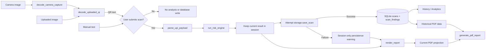

# QRivox — Code Explanation

This guide describes the files and data flow that exist in the current project. The application is a local prototype; its rules are not a calibrated fraud model and do not verify recipients.

## Important project files

| File | What it does |
|---|---|
| `app1.py` | Main Streamlit app. Contains the UPI parser, rule-based risk engine, explanation renderer, camera/upload/manual inputs, session history, scan persistence integration, analytics UI, and report download controls. |
| `storage.py` | SQLite connection setup, version-1 schema migration, validated scan writes, history reads, analytics SQL queries, filters, and historical report data retrieval. |
| `forensic_report.py` | Creates a PDF in memory. Projects the current scan into safe report fields or receives a saved historical scan. It does not rerun the risk engine for historical reports. |
| `evaluate_engine.py` | Runs the current parser and risk engine against a JSON dataset and prints category and review-signal summaries. |
| `evaluation_dataset.json` | Seven synthetic examples and expected scenario labels. It explicitly says the labels are not verified-fraud labels. |
| `requirements.txt` | Runtime package requirements. It includes Streamlit, Pillow, pyzbar, OpenCV, Requests, and ReportLab. |
| `packages.txt` | Lists `libzbar0`, a Linux package used to provide ZBar for QR decoding. |
| `README.md` | Describes local storage, privacy, analytics, PDF reports, and evaluator/test commands. |
| `tests/` | Parser/risk, workflow, storage, analytics, PDF, and evaluation tests. Tests use temporary databases and synthetic inputs. |
| `qr_safe_history.sqlite3` | Default local runtime database when `QR_SAFE_DATABASE_PATH` is not set. It contains persistent user scan history and must not be treated as a test fixture. |

## Main functions in simple English

### `app1.py`

- `parse_upi_payload(raw)` takes text and splits a UPI URI into fields. For example, `pa` is the payee address, `pn` is the payee name, `am` is the amount, and `cu` is the currency. It also records duplicate query parameters and creates a short display fingerprint. Missing optional fields get defaults; they are not automatically fraud findings.
- `run_risk_engine(payload)` evaluates the parsed fields with deterministic rules. It returns a report dictionary with a bounded score, verdict, findings, severity groups, and limitations. It does not call a remote service.
- `_finding(...)` creates a consistent finding dictionary: rule, category, severity, impact, reason, and a compatibility `detail` field.
- `_verification_findings()` adds three zero-impact information items: recipient identity is unverified, signatures are not validated, and no sourced malicious-account lookup is available.
- `_build_report(...)` subtracts negative finding impacts from 100, clamps the result to 0–100, and selects the verdict band.
- `_finding_next_step(finding)` chooses a cautious next step based on the finding rule.
- `_why_this_result(report)` finds the most negative listed impacts and explains which rules influenced the result most. When no finding reduced the score, it says so and clarifies that this is not verification.
- `_render_finding(finding)` displays detected rule, explanation, severity, impact, and next step. Dynamic text is HTML-escaped before styled rendering.
- `render_report(report)` displays the score and verdict, payment details, the “Why this result?” summary, separate warning and informational sections, and a reminder to verify payee and amount in the official payment app.
- `decode_uploaded_qr(image_file)` opens the image with Pillow, calls the imported pyzbar decoder, and handles unreadable images, no QR, decoder errors, and non-UTF-8 data.
- `decode_camera_capture(camera_capture)` passes the captured browser image to the same `decode_uploaded_qr` function. It is not a second decoder.
- `_store_scan(raw_payload)` runs parsing and analysis, stores the result in Streamlit session state, updates current-session history, and calls `storage.save_scan`. If persistence fails, it keeps the current report and displays a warning.
- `add_to_history(report)` creates the in-session summary row for a deliberate scan event.
- `render_history()` shows session history and lets the user choose a persisted scan for its PDF report.
- `render_analytics()` calls the storage aggregate and filter functions and shows counts, charts, search, filters, and per-scan findings.
- `_render_current_report_download(...)` and `_render_persisted_report_download(...)` prepare current or saved report data and display a Streamlit download button.
- `main()` builds the tabs and connects the input controls to the shared report, history, analytics, and report functions.

### `storage.py`

- `default_database_path()` uses `QR_SAFE_DATABASE_PATH` when set; otherwise it selects `qr_safe_history.sqlite3` beside the app.
- `connect_database()` opens SQLite, sets a row format, turns on foreign keys, and configures a busy timeout. A context manager closes the connection when done.
- `initialize_storage()` checks `PRAGMA user_version` and applies the schema migration in a transaction if needed.
- `_validated_scan(report)` validates the score and findings, calculates the full SHA-256 fingerprint, and selects only approved metadata fields for storage. Raw text is used to calculate the hash but is not inserted into a table.
- `save_scan(report)` writes one scan row and all its ordered findings atomically. Repeated fingerprints remain separate scan events.
- `get_recent_scans()` reads recent events. `get_scan_findings()` reads their findings in original order.
- `get_analytics_summary()` uses aggregate SQL for event/fingerprint totals, verdicts, dates, severities, and frequent rules.
- `search_scan_history()` performs parameterized fingerprint, verdict, and severity filters.
- `get_scan_summary()` and `get_scan_report_data()` read an individual scan and, for the report path, its stored original findings.

### `forensic_report.py`

- `current_scan_data(scan_report)` makes a report-safe projection from the current in-memory analysis and derives the full fingerprint. It excludes the raw QR text and prohibited fields.
- `generate_pdf_report(scan, report_id=None)` validates the score/findings, builds a ReportLab PDF in a `BytesIO` buffer, and returns the bytes and report ID. For a historical scan, its caller provides saved metadata and findings; the engine is not rerun.
- `ReportGenerationError` communicates a report generation failure so the UI can show a warning.

### `evaluate_engine.py`

- `load_dataset()` loads JSON and checks it is marked synthetic-only.
- `predicted_category()` maps the engine's findings to a scenario category.
- `evaluate_cases()` runs the existing parser/engine and compares predicted categories with expected scenario labels. Its “true/false positive/negative” numbers refer only to the dataset's expected **review signal**, not to confirmed fraud.
- `format_summary()` and `main()` print a readable report without using or modifying SQLite history.

## How information flows

Image decoding can happen when an image widget changes, but parsing, analysis, and a database write happen only after the user submits a scan. A normal Streamlit rerun does not make a second scan event by itself. Current and saved reports use the corresponding result snapshot.

## Important Python and software concepts to present

- **Functions:** Named blocks such as `parse_upi_payload` and `save_scan` keep work separated and reusable.
- **Dictionaries and lists:** The parser, report, and findings pass named values between functions. A findings list preserves order.
- **Exceptions:** Invalid images, database failures, and PDF errors are caught so the app can show a useful message instead of stopping unnecessarily.
- **Session state:** Streamlit reruns the script as controls change. `st.session_state` keeps the current report and history across those reruns.
- **Callbacks and button gating:** An input change can clear a stale result; the explicit scan button triggers analysis and persistence.
- **Regular expressions and `Decimal`:** Regular expressions identify exact keywords and URL text; `Decimal` validates amount values without binary floating-point rounding surprises.
- **SHA-256:** A cryptographic hash creates a full-length fingerprint for matching scan events. It is an identifier, not encryption.
- **SQL and transactions:** Parameterized SQL reads/filters data safely. One transaction writes a scan and all its findings together, preventing half-saved records.
- **Migration versioning:** SQLite `PRAGMA user_version` records which schema version has been applied.
- **Testing and mocks:** pytest checks functions; Streamlit `AppTest` checks UI workflows. Mocked decoder results make image tests deterministic, but they do not test a physical camera.

