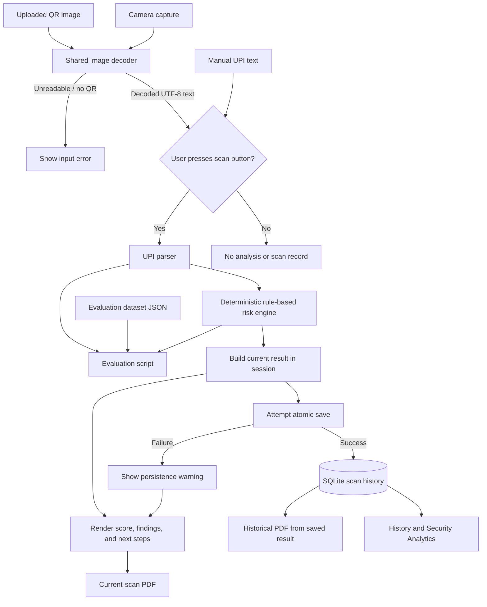

# QRivox

## Techfest 2026 KRITrIM Model Exhibition — Project Report

**Project type:** Software-only educational prototype  
**Implementation:** Python and Streamlit  
**Scope:** Local review of UPI QR payment payloads using deterministic format checks and heuristic indicators

## Abstract

UPI QR codes can encode payment details such as a recipient address and an optional amount. A person may scan a code without noticing that those details differ from the payment they intended to make. QRivox is a local Streamlit application that decodes an uploaded or webcam-captured QR image, or accepts a pasted payment URI, and presents the extracted fields with rule-based findings. It can save scan metadata and findings to SQLite, summarize saved events in an analytics view, and create a PDF report from a current or saved scan.

The score is a deterministic heuristic score, not a calibrated probability of fraud. The app does not verify account ownership, authenticate QR signatures, check a sourced malicious-account database, or guarantee payment safety. The project is a demonstration and review aid, not a replacement for a bank or payment application.

## Problem statement and motivation

A QR image is a convenient way to transfer text to a payment application, but the user still needs to verify the recipient and amount before approving a payment. QRivox demonstrates how software can expose selected fields and highlight a small set of structural or wording patterns for review. It also demonstrates basic data minimization by keeping the original payload and image out of persistent scan-history records.

The motivation is educational: help exhibition visitors understand what a payment QR can contain, how deterministic checks can be explained, and why automated indicators cannot establish that an account is fraudulent or legitimate.

## Objectives

- Accept UPI payment text from a camera image, uploaded image, or manual paste.
- Extract selected payment metadata and detect format problems or limited review indicators.
- Explain each finding, its severity, score impact, and a cautious next step.
- Persist limited scan history and findings locally in SQLite.
- Show aggregate analytics over saved scans and provide a PDF report for an individual scan.
- Evaluate the existing rules against a small, documented synthetic dataset.
- Clearly communicate privacy limits and what the app cannot verify.

## Proposed solution and implemented scope

The application uses one shared QR image-decoding path for uploaded images and webcam captures. A decoded string and manually pasted string use the same parser and risk engine. The user explicitly presses a scan button before the application analyzes and saves an event. The report then separates warnings/review indicators from informational observations, shows the recipient identifier and amount when present, and advises the user to verify those details in their official payment application.

Persistent scan history is stored in the existing SQLite database. Security Analytics reads that same database. The PDF generator uses either the current in-memory result or the saved historical result; it does not recompute old scans. The evaluation script reads the synthetic JSON dataset and does not use scan history.

## System architecture



The diagram shows the intended application flow. Automated tests exercise the Streamlit workflow and decoder paths, but a physical webcam/browser permission check still needs to be performed on the exhibition laptop.

## Technologies and their actual roles

| Technology | Role in this project |
|---|---|
| Python | Application, parser, deterministic rules, storage integration, PDF generation, and evaluation script. |
| Streamlit | Local web interface, input tabs, camera and upload controls, findings, charts, history, and download buttons. |
| Streamlit `camera_input` | Requests a webcam image from the browser; that capture is passed to the shared image decoder. |
| Pillow | Opens and loads uploaded or captured image data before decoding. |
| `pyzbar` / ZBar | Reads QR contents from the Pillow image. `packages.txt` lists `libzbar0` for Linux environments. |
| Python standard library | URI parsing (`urllib.parse`), decimal validation (`decimal`), pattern checks (`re`), SHA-256 (`hashlib`), timestamps, JSON, and SQLite interfaces. |
| SQLite | Local persistent scan events and ordered findings; no second analytics or threat-intelligence database is used. |
| ReportLab | Builds PDF reports in memory. |
| `pytest` and Streamlit `AppTest` | Automated unit and Streamlit workflow tests. The test suite also uses `pypdf` to inspect generated PDFs. |
| JSON | Stores the synthetic evaluation cases in `evaluation_dataset.json`. |

`requirements.txt` also lists `opencv-python` and `requests`; the inspected core application modules do not directly use them. `pytest` and `pypdf` are test dependencies used by the suite but are not listed in `requirements.txt`.

## Working principle and workflow

1. **Input:** The user selects the QR image tab and captures an image, uploads an image, or opens the manual tab and pastes text.
2. **Decode:** For an image, Pillow loads the bytes and `pyzbar` attempts to decode a QR symbol. Unreadable files, images without a QR, and non-UTF-8 QR data return user-facing errors.
3. **Submit:** For decoded images or pasted text, the user presses the relevant **Run Forensic Scan** button (the camera button is **Analyze Captured QR**). Merely displaying or decoding an image does not save a scan.
4. **Parse:** `parse_upi_payload` extracts the URI fields, including payee address (`pa`), payee name (`pn`), amount (`am`), currency (`cu`), reference (`tr`), note (`tn`), MCC, mode, signature text, and duplicate query parameters.
5. **Analyze:** `run_risk_engine` checks the URI structure, payee-address shape, duplicate parameters, amount validity, exact whole-word keyword matches, and URL text. It also adds informational observations about verification limits.
6. **Explain:** The report shows the score, cautious verdict, recipient/amount values when available, grouped informational and warning findings, per-finding next steps, and a “Why this result?” summary. It reminds the user to verify the payment details in the official payment app.
7. **Persist:** On a submitted scan, the application calculates a full SHA-256 fingerprint and saves it with limited metadata and ordered findings. Raw QR text and image bytes are not inserted into the database. If storage fails, the current result remains available in the session and the app displays a warning.
8. **Review or export:** Scan History and Security Analytics query the same SQLite file. A PDF download can be generated for the current scan or a selected persisted scan.

## Software flowchart

The flowchart above is the software flowchart. A shorter explanation is: **capture/paste → decode if needed → explicit scan button → parse URI → run rules → display explanations → save scan event → history/analytics/report**. Decode errors stop that input path before risk analysis; a database error does not erase the current in-session result.

## Database design and privacy

The database defaults to `qr_safe_history.sqlite3` beside `app1.py`. `QR_SAFE_DATABASE_PATH` can select a different local file. Schema version 1 is tracked using SQLite `PRAGMA user_version`; connections enable foreign keys and a five-second busy timeout.

| Table | Stored fields |
|---|---|
| `scans` | `scan_id`, UTC scan timestamp, full SHA-256 fingerprint, score, verdict, payee VPA, payee name, amount, currency, merchant category code, and mode. |
| `scan_findings` | Finding ID, parent scan ID, original position, rule, category, severity, explanation, and score impact. A foreign key links each finding to its scan. |

Each deliberate scan action creates an event, even when its fingerprint matches an earlier scan. Scan and finding rows are saved in one transaction. History and analytics describe this application's records; they are not threat intelligence.

The database excludes raw QR payloads, image bytes, transaction notes, transaction references, and signature values. It does store the VPA and payee name, which can identify a recipient. The SQLite file is local and unencrypted. The raw payload is retained in the active scan report/session for display and current processing; the privacy statement is specifically about persistent storage, not the transient application session. A hash is not encryption and may be guessable for predictable inputs.

## Risk scoring and detection methodology

The engine starts at 100, subtracts the negative impacts of findings, and bounds the result to 0–100. This is a deterministic rule score, not a probability or a validated fraud-risk measure.

| Rule family | Existing behavior |
|---|---|
| URI format | A scheme/authority mismatch produces a HIGH format finding (−65). A missing or incomplete `pa` address produces a HIGH format finding (−45). |
| Duplicate parameters | Duplicate query parameters produce a MEDIUM format finding (−25), because different payment software may interpret duplicates differently. |
| Amount | A non-finite, non-positive, or malformed amount produces a MEDIUM format finding (−25). A valid pre-filled amount is informational (INFO, 0 points). |
| Wording | Exact whole-word matches from the configured keyword list produce an indicator: one match is LOW (−8); multiple matches are MEDIUM, with a maximum 24-point deduction. Wording can be legitimate and is not proof of fraud. |
| URL text | HTTP/HTTPS text found in payment metadata produces a MEDIUM indicator (−20). It does not establish that a URL is followed or malicious. |
| Verification limitations | Recipient identity, signature validation, and a sourced malicious-account lookup are recorded as informational limitations with zero impact. |

Verdict bands are based on the resulting score: 85–100 **NO HIGH-RISK INDICATORS**; 60–84 **REVIEW DETAILS**; 35–59 **SUSPICIOUS INDICATORS**; 0–34 **MULTIPLE HIGH-RISK SIGNALS**. A low-severity finding can therefore appear while the verdict is “NO HIGH-RISK INDICATORS”; the findings and summary should be read with the score. No account is labeled as a verified malicious match.

## Actual testing and evaluation results

On 2026-10-10, the full suite was run with:

```text
python -m pytest -q -p no:cacheprovider tests
64 passed in 7.43s
```

The command exited successfully. Python printed a `PermissionError` during Windows temporary-directory cleanup after the test summary; this did not change pytest's successful exit status. Tests cover parser fields and errors, scoring structure and bounds, informational zero-impact findings, workflow/session behavior, camera widget rendering and camera-image helper behavior, SQLite transactions/privacy/failures, analytics, PDF generation, and evaluation.

The suite does **not** prove physical webcam operation or actual browser permission behavior. Camera image decoding tests use a mocked QR decoder; the AppTest verifies that the camera control renders without an error when no capture is present.

The synthetic evaluator was also run with `python evaluate_engine.py`:

- Total cases: **7**
- Expected category matched: **7**
- Incorrect categories: **0**
- Review-signal counts: **5 true positives, 2 true negatives, 0 false positives, 0 false negatives**
- Scenarios: one normal fixed-amount case, one missing-optional-fields case, two malformed cases, one suspicious-wording case, one URL-text case, and one duplicate-parameter case.

These counts compare synthetic labels for expected parser/review behavior. They do not measure real-world fraud accuracy. In particular, the suspicious-wording case is categorized as having an indicator even though its verdict remains “NO HIGH-RISK INDICATORS”; a single keyword currently reduces the score by only eight points.

## Applications and expected impact

- Classroom and exhibition demonstration of URI parsing, QR decoding, explainable rules, and local persistence.
- A teaching aid for inspecting recipient and amount fields before moving to a payment application.
- Demonstration of data minimization, SQLite migrations, analytics queries, and historical PDF reporting.
- Expected impact is improved awareness of QR contents and system limitations. No measured reduction in fraud or user study is claimed.

## Limitations and future improvements

### Current limitations

- The engine is a small set of hand-written heuristics, not a validated detector. It can produce false positives and miss harmful QR codes.
- It cannot verify the recipient/account owner, merchant registration, signature authenticity, URL destination, or a known-malicious match.
- The parser and rule set do not claim official UPI/NPCI compliance.
- The stored VPA and payee name are sensitive and the local SQLite file is unencrypted.
- The physical webcam and browser permission flow still require a manual check on the exhibition machine.
- The synthetic dataset has only seven cases and no confirmed-fraud labels.
- `pytest` and `pypdf` are needed to run the suite but are not specified in `requirements.txt`.

### Possible future work (not implemented)

- Run a repeatable webcam/browser test on the actual exhibition laptop and several QR image qualities.
- Expand parser tests against documented URI formats and edge cases without claiming certification.
- Build a larger, carefully sourced and privacy-reviewed evaluation dataset with independently verified labels before measuring performance.
- Consider local database encryption, retention controls, and backup if the project is ever used beyond a classroom prototype.
- Document test-only dependencies separately so contributors can reproduce the suite.

## Software requirements and estimated project cost

### Software requirements observed in the project

- Python with syntax support for modern type annotations (Python 3.10 or later is a practical baseline).
- Packages listed in `requirements.txt`: Streamlit, Pillow, `pyzbar`, OpenCV, Requests, and ReportLab.
- ZBar native support for `pyzbar`; `packages.txt` lists `libzbar0` for Linux deployments.
- For automated tests: pytest and pypdf are also required by the current test files, although they are not in `requirements.txt`.
- A browser for the Streamlit interface. Webcam capture requires that the browser can access an available camera and that the user grants permission. Image upload and manual input remain alternatives.
- SQLite is accessed through Python's standard library; no separate database server is required.

### Cost estimate (incremental project cost)

| Item | Estimate and assumption |
|---|---|
| Existing laptop | ₹0 new cost; the laptop is assumed to be already owned. Its original purchase price is not counted as a project expense. |
| Existing internet connection | ₹0 incremental cost for local scanning after software dependencies are installed. Existing plan costs are excluded; an internet connection is not used by the detection workflow or evaluator. |
| Webcam | ₹0 if the laptop camera is available. No new webcam is required because upload and manual-paste inputs are also implemented. If a separate camera must be purchased, its price depends on the buyer and is not estimated here. |
| Software/API/cloud services | ₹0 project-specific service cost; the inspected workflow uses local Python, Streamlit, and SQLite and does not call an external fraud API. |
| **Estimated incremental total** | **₹0 under the existing-laptop and available-camera-or-alternative-input assumptions.** |

